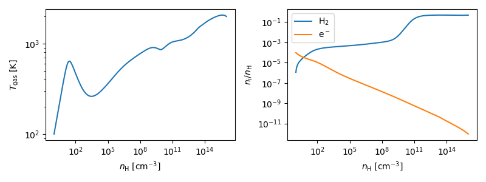

# KROME-X

KROME-X is a rewrite of KROME, the chemistry and microphysics package for
astrophysical simulations. It reads a chemical network, generates code
for it, and provides a stiff solver for the chemistry and the gas
temperature. It is a C/C++ library, with optional Fortran and Python
bindings, and it was designed to allow GPU offloading.

- **The physics is fixed at generation.** Coolers, heaters, shielding,
  the adiabatic index and the other process choices are code generator
  flags. The generated code contains only what was chosen. At runtime
  you set only numerics (tolerances, Jacobian, solver path) and
  `evolve_T` (fixed-Tgas chemistry or evolved Tgas).
- **Parameters that a process needs have no default.** Examples are
  `tff` for compression heating and `crate` for cosmic rays. The solver
  rejects a cell where such a parameter is left unset.
- **Species order is alphabetical**, by code point. Use the generated
  constants (`IDX_H2`, `KROME_IDX_H2`, `krome_idx_H2`, `net.idx("H2")`)
  and never hard-code an index.

Documentation:

- [docs/manual.md](docs/manual.md), the user manual:
  - every generation option, runtime option, parameter and return flag;
  - C++, C, Fortran and Python usage;
  - migrating from legacy KROME: every legacy option and its key.
- `krome.hpp` (C++) and `krome.h` (C): the documented API headers, in
  every generated project.
- [docs/network-format.md](docs/network-format.md): the `.knet` network
  format.

## Installation

```sh
pip install .            # in the KROME-X folder: the package and its commands
pip install -e .         # the same, editable: it reads this folder (for development)
```

Python 3.8 or newer, with numpy. Without installation, the package also
works from the KROME-X folder itself: Python started there finds
`kromex`, and the command is `python3 -m kromex` (a script elsewhere
adds the folder to `sys.path`, or is run with `PYTHONPATH`). Building
the generated projects needs a C++17 compiler (Requirements, below).

## Quick start

A project is generated from a configuration: the network and the
physics options, grouped in sections.

```python
from kromex import Preprocessor

kp = Preprocessor(network="primordial")     # a shipped network, or a .knet path
kp.thermal.cooling = ["ATOMIC", "H2"]
kp.thermal.heating = ["CHEM", "COMPRESS"]
kp.project.bindings = ["fortran", "python"]
kp.run("myproj")              # generate the project
net = kp.build()              # compile it (make shared) and load it
```

Every value is checked when it is set, and a misspelled option is an
error that names the closest ones. `build()` compiles the project and
returns its Python `Network`; the solving is yours:

```python
n = net.densities({"H": 1e4, "H+": 1.0, "e-": 1.0, "He": 775.0})  # [cm^-3]
opts = net.options(evolve_T=True)            # Tgas evolved with the chemistry
r = net.solve(n, 100.0, 3.15e10, par={"tff": 1e14}, opts=opts)  # 1000 yr
print(r.Tgas, r.n[net.idx("H2")])            # the final state, r.flags
```

`tff` is required here because of the COMPRESS heating (NETWORK.md, in
the project, lists every parameter).

These examples are also Jupyter notebooks, with their outputs, in
`examples/coupling/python/`: `quickstart.ipynb` (this section, and a cell
followed in time), `collapse.ipynb` (the collapse below, with and
without the continuum cooling) and `networks.ipynb` (documenting and
converting networks). The same cell followed in time is in
`examples/coupling/` in C, C++ and Fortran too.

## Example: a primordial collapse

A one-zone free-fall collapse of primordial gas, from 1 to 10^16 cm^-3:
the density grows by 1% every 0.01 free-fall times, and the chemistry
and Tgas are solved over each step, as a hydro code would call KROME.
The physics is that of the shipped collapse test (`--test collapse`),
which needs the H2 line opacity and the continuum cooling at high
density:

```python
import numpy as np
import matplotlib.pyplot as plt
from kromex import Preprocessor

kp = Preprocessor(network="primordial3")
kp.thermal.cooling = ["H2", "CONT", "CHEM"]
kp.thermal.heating = ["COMPRESS", "CHEM"]
kp.thermal.h2_opacity = "RIPAMONTI"
kp.thermal.gamma = "EXACT"
kp.run("collapse")
net = kp.build()

n = net.densities({"H": 1.0, "H+": 1e-4, "e-": 1e-4, "H2": 1e-6,
                   "He": 0.0775})              # n_H = 1 cm^-3
Tgas, nH = 100.0, 1.0
opts = net.options(evolve_T=True)
hist = []
while nH < 1e16:
    tff = float(net.free_fall_time(n))        # the compression time [s]
    n, nH = n * 1.01, nH * 1.01               # the density grows 1% ...
    r = net.solve(n, Tgas, 0.01 * tff,        # ... in 0.01 tff: solve it
                  par={"tff": tff}, opts=opts)
    n, Tgas = r.n, float(r.Tgas)
    hist.append((nH, Tgas, n[net.idx("H2")] / nH, n[net.idx("e-")] / nH))

nH, T, xH2, xe = np.array(hist).T
fig, (a, b) = plt.subplots(1, 2, figsize=(8, 3))
a.loglog(nH, T)
a.set(xlabel=r"$n_\mathrm{H}$ [cm$^{-3}$]", ylabel=r"$T_\mathrm{gas}$ [K]")
b.loglog(nH, xH2, label=r"H$_2$")
b.loglog(nH, xe, label=r"e$^-$")
b.set(xlabel=r"$n_\mathrm{H}$ [cm$^{-3}$]", ylabel=r"$n_i / n_\mathrm{H}$")
b.legend()
fig.tight_layout()
fig.savefig("collapse.png")
```

The 3700 steps take about half a second on a laptop.



Compression heats the gas to ~600 K, and H2 cooling brings it down to
~300 K around 10^3 cm^-3. The gas then warms as the H2 lines become
optically thick, and three-body H2 formation turns it fully molecular
around 10^10-10^11 cm^-3. Above 10^13 cm^-3 the continuum cooling keeps
the temperature near 2000 K up to 10^16 cm^-3; the shipped test, which
continues to 10^18 cm^-3, reaches 3000 K.

## Using KROME-X from C, C++ and Fortran

Every project is a C/C++ library, with the optional Fortran binding:

```sh
cd myproj
make                                    # libkrome.a + the C++ example
make fortran example_f90                # Fortran modules + example
make shared                             # libkrome.so/.dylib for krome.py
```

```cpp
#include "krome.hpp"          // the whole C++ API
using namespace krome;

double n[NSPEC] = {};         // [cm^-3]
n[IDX_H] = 1e4; n[IDX_Hj] = n[IDX_E] = 1.0; n[IDX_He] = 775.0;
double Tgas = 100.0;
Params p;  p.tff = 1e14;      // REQUIRED by thermal.heating = ["COMPRESS"]
SolverOpts o;  o.evolve_T = true;
int flag = solve(n, Tgas, p, 1e10, o);
if (flag != FLAG_OK) printf("%s\n", flag_message(flag));
```

The other entry points, all described in the manual:
- `solve_cells`, for many cells, per-cell parameters, OpenMP or the
  device;
- mass fractions (`solve_x`, legacy `-useX`);
- the equilibrium solver;
- queries, photon bins and binned dust, with evolving grain sizes
  (`dust.evolve`: growth, sputtering, evaporation);
- line cooling from user coolant files (`thermal.coolant_files`: LAMDA and CHIANTI
  conversions, `lamda2krome` and `chianti2krome`);
- `KROME_ERROR_REPORT`, written when a solve fails;
- the legacy tests ported to KROME-X (`python3 -m kromex --test NAME`),
  and examples calling KROME-X from C, C++, Fortran and Python
  (`examples/coupling`).

## Configuration files

The same configuration as a TOML file:

```toml
# myrun.toml
[project]
network = "primordial"
outdir = "myproj"
bindings = ["fortran", "python"]

[thermal]
cooling = ["ATOMIC", "H2"]
heating = ["CHEM", "COMPRESS"]
```

```sh
kromex myrun.toml                                 # generate
kromex myrun.toml --set thermal.gamma=EXACT       # with an override
```

(`python3 -m kromex` without the installation.)

In Python, `Preprocessor.from_file("myrun.toml")` reads it and
`kp.save("myrun.toml")` writes one. `options_template.toml` lists every
option, commented out, with its explanation and default: copy it and
uncomment what you need.

Before generating, `python3 -m kromex --check myrun.toml` (or
`kp.check()`) checks a network: the generated code against an
independent evaluation, rates that are NaN, negative or implausibly
large, species never formed or destroyed, reactions written twice. In a
project, `make check` builds everything and compares the rates of your
build with reference values.

Every project records its configuration in `krome.toml`, which
regenerates it (`python3 -m kromex myproj/krome.toml`); `NETWORK.md`
lists the options together with this network's species, parameters and
reactions.

## Documenting a network

```sh
python3 -m kromex_doc primordial -o doc_primordial    # then open doc_primordial/index.html
```

writes the documentation of a network from its `.knet` file, with no
build: a page per species and per reaction (the rate as a formula, k
against T), the jumps of piecewise rates at their bounds, the missing
reactions and branches, a graph per element, and the reaction table for
a paper in LaTeX (docs/manual.md section 2).

## Layout

| path | contents |
|---|---|
| `kromex/` | the code generator, used from this folder: `Preprocessor` (`preprocessor.py`, the configuration and the generation), the option definitions (`config.py`), the command line (`python3 -m kromex`, `__main__.py`), the generator (`codegen.py`: network -> project), the `.knet` parser (`knet.py`), the converter of legacy `react_*` files (`convert_legacy.py`), the physical constants (`constants.py`) |
| `kromex_doc/` | the documentation of a network (`python3 -m kromex_doc`; legacy docmake): HTML site and LaTeX table, from the `.knet` |
| `options_template.toml` | every generation option, commented out, with its description, default and an example |
| `runtime/` | the library, copied into each generated project |
| `networks/` | the legacy networks converted to `.knet` |
| `data/` | the databases and tables KROME reads (their sources and what to cite: `data/data_sources.md`); `data/cooling/` the coolant files for `thermal.coolant_files` |
| `examples/` | `examples/tests/`: the legacy tests ported to KROME-X (`python3 -m kromex --test NAME`); `examples/coupling/`: the quick start's cell from C, C++ and Fortran, and the README's examples as Jupyter notebooks (`python/`) |
| `kromex_convert/` | the converters of external data (commands, or `python3 -m kromex_convert.NAME`): `kida2krome` and `umist2krome` (networks from KIDA and the UMIST database), `lamda2krome` and `chianti2krome` (coolant files from LAMDA and CHIANTI) |
| `docs/` | the manual and the network format |

The runtime:

| file | contents |
|---|---|
| `krome.hpp` | the public C++ API: types, options, documented declarations |
| `interfaces/C/` | the C interface, `krome.h` and `krome.cpp` (`libkrome.a`) |
| `interfaces/fortran/krome.f90`, `interfaces/python/krome.py` | optional bindings over the C interface |
| `core/` | the implementation: solver (`solve*.hpp`), queries, physics modules, embedded data tables (internal) |
| `core/cvode/` | the integrator, CVODE's BDF ported from SUNDIALS 7.9 (`bdf_cell.hpp`), with the SUNDIALS license (`LICENSE.sundials`) |

## Requirements

- Python 3.8 or newer and numpy (`pip install .` installs the package and
  numpy; without installation, run it from this folder);
- a C++17 compiler (no external solver library: the integrator, a port
  of CVODE's BDF from SUNDIALS 7.9, is part of the headers,
  `runtime/core/cvode/bdf_cell.hpp`, BSD-3 license in
  `runtime/core/cvode/LICENSE.sundials`);
- optional:
  - gfortran, for the Fortran binding;
  - LAPACK (Accelerate, OpenBLAS, MKL), for large networks;
  - Kokkos 4.x, for the device backend (GPU or OpenMP: one thread per
    cell).

## License

KROME-X is distributed under the GNU General Public License v3.0
(`LICENSE`). The integrator ported from SUNDIALS keeps its BSD-3 license
(`runtime/core/cvode/LICENSE.sundials`), and the bundled `tomli` its MIT
license. The data files in `data/` are not covered by the GPL: they keep
the terms of their providers, listed with their sources and citations in
`data/data_sources.md`. In particular, Burcat's thermochemical database
(`data/thermo_burcat.toml`, used for reverse reactions and the `DH`
heating and cooling) may not be included in commercial software without
its authors' permission.

